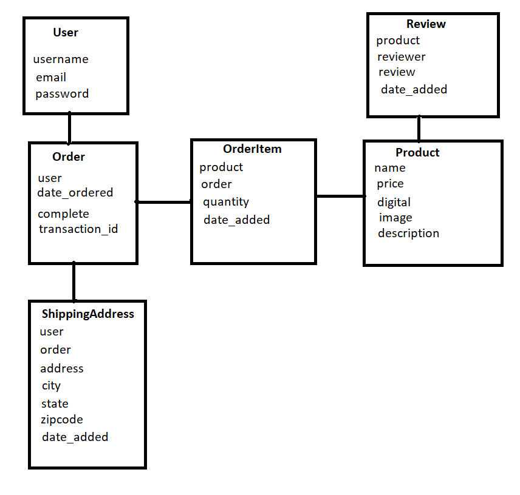

# E-commerce

An online store built with Python and Django. Shoppers can browse products, read and write reviews, keep a cart (as a guest or with an account), and check out with PayPal. Registered users can also list their own products for sale, including digital products that don't need shipping. It is based on the Code With Steps e-commerce tutorial, with accounts, product pages, reviews, "Buy now" and product uploads added on top.


The demo was recorded on a local copy with sample products. It stops before payment because the PayPal buttons load from paypal.com, which wasn't available in the recording environment. An earlier video walkthrough, including checkout, is on [YouTube](https://youtu.be/bOfClMkb2wo).

## Features

- **Product catalog:** a grid of products with an image, name, price and "Add to cart" button.
- **Product pages:** a description, a quantity selector, "Add to cart" and "Buy now" buttons, and the customer reviews with a review count.
- **Reviews:** logged-in users can write a review for a product. Each user has one review per product; submitting again updates it, and the form is pre-filled with their current review.
- **Cart for guests and users:** guests' carts are kept in a browser cookie, and logged-in users' carts are saved in the database. The cart page shows each item's price, quantity and total, with arrows to change the quantity, and the cart icon shows the item count.
- **Checkout:** guests enter a name and email. The shipping form appears only when the order contains a physical product. Payment uses PayPal buttons, and once PayPal approves the payment the order is saved as complete along with the shipping address.
- **Buy now:** buy a single product straight from its page without going through the cart.
- **Accounts:** register (username, email and password), log in, log out and see a profile page.
- **Selling:** from the profile page, users can upload a product with a name, price, image, description and whether it is digital.
- **Admin:** products, orders, order items, shipping addresses and reviews can be managed in the Django admin.

## What I added beyond the tutorial

The tutorial covers the product list, the guest and user carts, checkout and the PayPal payment. I added:

- User registration, login and logout.
- A page for each product, where logged-in users can write or edit a review and read other users' reviews.
- "Buy now" and "Add to cart" (with a quantity) on the product page.
- A form for logged-in users to upload their own products to sell.

## How it works

1. **Models:** `Product`, `Review`, `Order` (a cart until `complete` is set), `OrderItem` and `ShippingAddress`.

   

2. **Cart:** for logged-in users, `cart.js` sends add and remove actions to `/update_item/` with `fetch`, and the server updates the open `Order`. For guests, it stores the cart as JSON in a `cart` cookie, and `utils.py` reads that cookie to build the same cart data on the server.
3. **Checkout:** after PayPal approves a payment, the page posts the order details to `/process_order/` (or `/process_order_now/` for "Buy now"). For cart orders, the server marks the order complete only if the total sent by the page matches the cart total. It also saves the shipping address when the order needs one. For guests, it creates a user record from the name and email so the order can be tracked.
4. **Uploads:** the product form is a Django `CreateView`. Uploaded images are saved in `store/static/store/images/` and served at `/images/`.

## Project structure

```
e_commerce/               Django project settings and URLs
store/                    The app
├── models.py             Product, Review, Order, OrderItem and ShippingAddress
├── views.py              Store, product page, reviews, cart, checkout, buy now, upload and accounts
├── utils.py              Cookie cart for guests, cart data and guest orders
├── forms.py              Review and registration forms
├── urls.py               URL routes
├── templates/store/      Store, product, cart, checkout, buy now, profile and form pages
└── static/store/
    ├── js/cart.js        Add/remove cart items (cookie or fetch)
    ├── css/main.css
    └── images/           Product images, icons and the model diagram
Spec.txt                  The original project goals
```

## Running it locally

The repository has no `requirements.txt`. The migrations were made with Django 3.1.3, and I tested it with **Python 3.9** and these packages:

```bash
python3.9 -m venv venv
source venv/bin/activate
pip install Django==3.1.3 django-bootstrap4==2.3.1 Pillow==8.0.1
python manage.py migrate
python manage.py createsuperuser
python manage.py runserver
```

The database isn't included, so the store starts empty. Add products by logging in and using the upload form on the profile page, or in the admin at http://127.0.0.1:8000/admin. Then open http://127.0.0.1:8000.

The pages load Bootstrap and the PayPal JavaScript SDK from the internet. The PayPal client ID is set in `checkout.html` and `buy_now.html`; to test payments, replace it with your own PayPal sandbox client ID.

## Built with

- **Backend:** Python, Django 3.1, SQLite, Pillow (image uploads) and django-bootstrap4 (form layout)
- **Frontend:** HTML, CSS, Bootstrap 4 and JavaScript
- **Payments:** PayPal JavaScript SDK

## Credit

This project is based on the e-commerce tutorial from Code With Steps (codewithsteps), which covered the store, the cart, guest checkout with cookies and the PayPal integration. The tutorial's website is no longer online.

Created by Sangye Tenphel, 2020.
